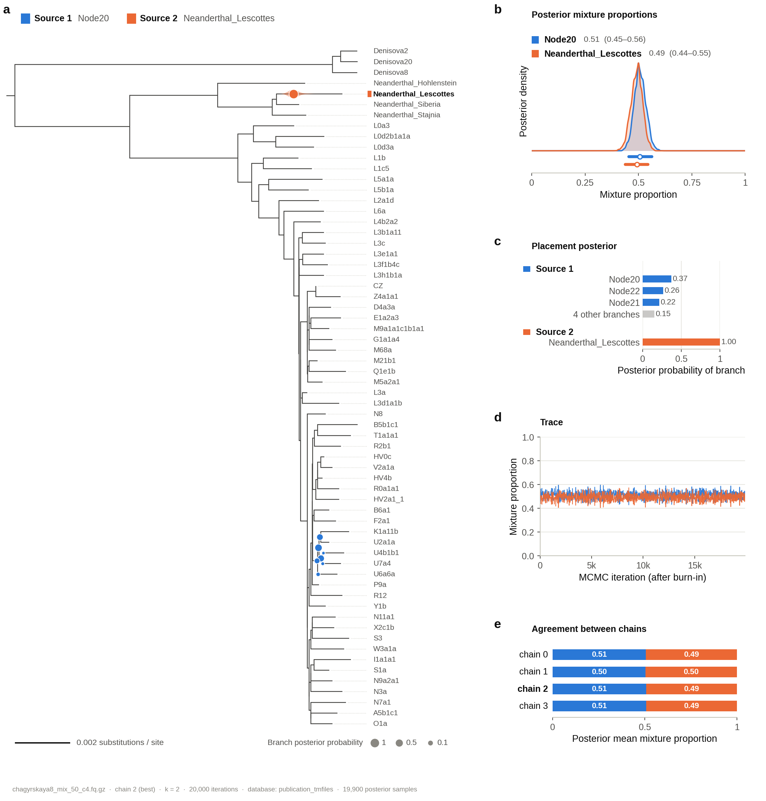
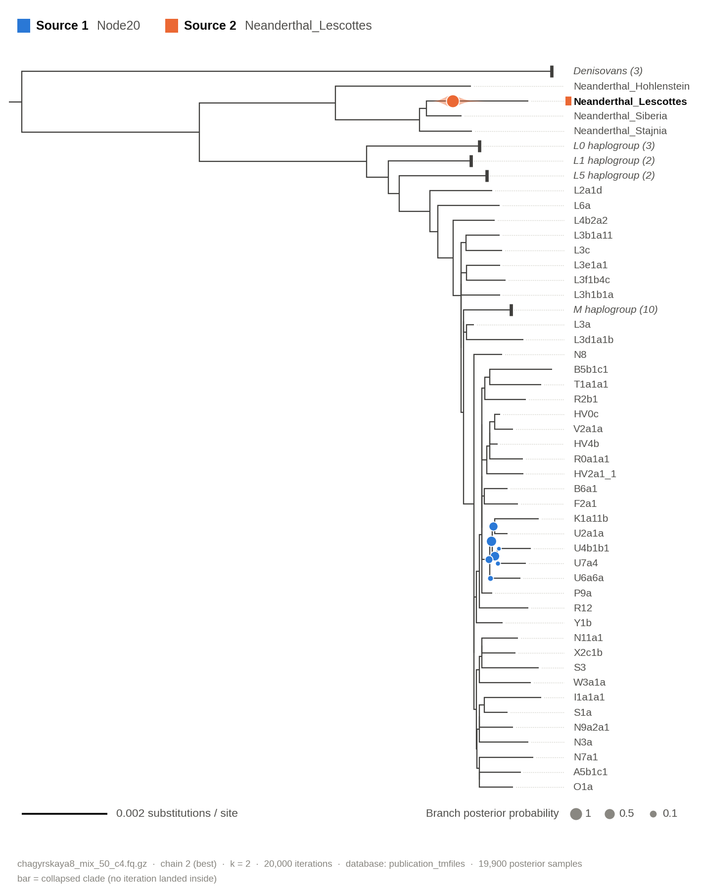

[](http://bioconda.github.io/recipes/vgan/README.html)
# vgan

vgan is a suite of tools for pangenomics. We currently support four main subcommands: [HaploCart](#haplocart) (for modern human mtDNA haplogroup classification), [euka](#euka) (for bilaterian taxa detection and abundance estimation of ancient environmental DNA), [soibean](#soibean) (for species identification and multiple source estimation of filtered bilateria data from ancient environmental DNA) and [TrailMix](#trailmix) (for the deconvolution and phylogenetic placement of hominin sedaDNA mixtures). The underlying data structure is the VG graph (see https://github.com/vgteam/vg).

**vgan is supported for use on Linux systems.**

## Contents

1. [Installation](#installation)
2. [euka](#euka)
3. [HaploCart](#haplocart)
4. [soibean](#soibean)
5. [TrailMix](#trailmix)
6. [aeDNA example workflow](#aedna-example-workflow)
7. [Unit tests](#unit-tests)
8. [Support](#support)

---

## Installation

Paths below assume the vgan folder structure in `$HOME/share/vgan/` (created in step 3 of the release build). If you built vgan from source, the same folders are in `share/vgan/` of your clone.

### Release build (recommended)

The easiest way to run vgan is the static binary of a [release](https://github.com/grenaud/vgan/releases). It is a single file for **Linux on x86_64** (64-bit Intel/AMD; `uname -m` prints `x86_64`) with no dependencies: no compiler, no libraries, no root. It does not run on macOS or on ARM machines (including Apple silicon and Raspberry Pi); use [Bioconda](#bioconda) or [build from source](#building-vgan-from-source) there.

**Where vgan looks for its files.** vgan finds its database files relative to the folder that holds the executable: the databases in `../share/vgan/` and, for TrailMix, the SAFARI mapper in `../dep/safari_vg/bin/vg`. If the executable is `$HOME/bin/vgan`, that is `$HOME/share/vgan/` and `$HOME/dep/safari_vg/bin/vg`, which is what the steps below create. A symbolic link is followed to the real file, so link to `vgan` from elsewhere if you like, but keep the real file next to the `share` and `dep` folders. The database folders can also be given with `--euka_dir`, `--hc-files`, `--soibean_dir` and `--tm-files`; the SAFARI mapper and the default damage profile `share/vgan/damageProfiles/none.prof` cannot be moved.

**Step 1**: Download the binary. Use `curl -L` (the link redirects; without `-L` you save a small HTML file instead of the program).

```
mkdir -p $HOME/bin
curl -L -o $HOME/bin/vgan https://github.com/grenaud/vgan/releases/download/v4.0.0/vgan-linux-x86_64
chmod +x $HOME/bin/vgan
```

The release page lists the SHA-256 of the file. Compare it with `sha256sum $HOME/bin/vgan`. Older releases are listed at https://github.com/grenaud/vgan/tags.

**Step 2**: Put the folder on your `PATH` (add the second line to `~/.bashrc` to keep it) and test:

```
export PATH=$HOME/bin:$PATH
vgan version
```

This should print the version (`vgan v4.0.0`) and nothing else. If you get `Permission denied`, the `chmod` was skipped, or the folder is on a file system mounted `noexec` (use another folder, for example one in `/opt` or `/scratch`). `cannot execute binary file: Exec format error` means the machine is not x86_64. An output of a few bytes or an error that mentions HTML means the download did not follow the redirect.

**Step 3**: Create the vgan folder structure:

```
mkdir -p $HOME/share/vgan/{euka_dir,hcfiles,soibean_dir,tmfiles,damageProfiles,plottingScripts}
mkdir -p $HOME/dep/safari_vg/bin
wget -O $HOME/share/vgan/damageProfiles/none.prof https://raw.githubusercontent.com/grenaud/vgan/main/share/vgan/damageProfiles/none.prof
```

`none.prof` ("no damage") is the damage profile that euka, soibean and TrailMix use when you do not give one with `--deam5p`/`--deam3p`.

**Step 4** (TrailMix only): Download the SAFARI mapper, a separate 790 MB static program that TrailMix starts to map the reads. HaploCart, euka and soibean do not need it.

```
curl -L -o $HOME/dep/safari_vg/bin/vg https://github.com/grenaud/SAFARI/releases/download/v1.0.1/vg
chmod +x $HOME/dep/safari_vg/bin/vg
```

**Step 5**: Download the database files of the subcommands you want to use, see [Database files](#database-files). To try TrailMix, continue with the [TrailMix quick start](#trailmix-quick-start).

### Bioconda

Make sure conda is installed or follow the conda install guide: https://docs.conda.io/projects/conda/en/latest/user-guide/install/index.html. The Bioconda channel must be installed in your environment.

To install vgan, use:

```
conda install -c bioconda vgan
```

When using vgan via conda, you also must download the database files, see [Database files](#database-files). vgan looks for them relative to its executable, so with conda the folders are `$CONDA_PREFIX/share/vgan/` (and `$CONDA_PREFIX/dep/safari_vg/bin/vg` for TrailMix), not `$HOME/share/vgan/`; or point to the folders with `--euka_dir`, `--hc-files`, `--soibean_dir` and `--tm-files`. The Bioconda package can be older than the latest release (check `vgan version`); for TrailMix use the release binary or build from source. You can find detailed instructions for each subcommand in its section below.

### Database files

The database files are hosted on Google Drive as `.tar.gz` archives. Each archive unpacks into one folder named like the archive. That folder belongs in `$HOME/share/vgan/`, or anywhere else if you point the subcommand to it with `--euka_dir`, `--hc-files`, `--soibean_dir` or `--tm-files`.

| Archive | Size | Used by | Link |
|---|---|---|---|
| `euka_dir.tar.gz` | 1.3 GB | [euka](#euka) | [download](https://drive.google.com/file/d/1cHDZujMQaMiJxZHhSD56BqlziJWthhPk/view?usp=sharing) |
| `hcfiles.tar.gz` | 91 MB | [HaploCart](#haplocart) | [download](https://drive.google.com/file/d/1gPue0IKdEz3UpY2KMbAHnXZXKvEcCdmQ/view?usp=sharing) |
| `soibean_dir.tar.gz` | 459 MB | [soibean](#soibean) | [download](https://drive.google.com/file/d/1Hzjs4Bc8V71OYp8vY7waI2Q2x4vi8fSP/view?usp=sharing) |
| `tmfiles.tar.gz` | 558 MB | [TrailMix](#trailmix) | [download](https://drive.google.com/file/d/1jPs3artDM_tpKSo0WQgDrqnV9WIk3_Nh/view?usp=sharing) |
| `publication_tmfiles.tar.gz` | 2.9 MB | [TrailMix](#trailmix) (database of the publication) | [download](https://drive.google.com/file/d/1VN4AWAj2J-YQ-5NZXcXTxSTBJiYHaOFB/view?usp=sharing) |

**Download and unpack.** Each section below has the commands for its archive. They all have the same form, here for the publication database:

```
cd $HOME/share/vgan
curl -L -o publication_tmfiles.tar.gz "https://drive.usercontent.google.com/download?id=1VN4AWAj2J-YQ-5NZXcXTxSTBJiYHaOFB&export=download&confirm=t"
tar -xzf publication_tmfiles.tar.gz && rm publication_tmfiles.tar.gz
ls publication_tmfiles
```

You can also download in a browser from the links in the table, and `gdown [file id]` (`pip install gdown`) works as well. The `.tar.gz` can be deleted after unpacking. If `tar` says `not in gzip format`, Google returned a web page instead of the file (the file has been downloaded too often in the last 24 hours, or it is not shared): download it in a browser and copy it over, or use `gdown`.

**Disk space.** Unpacked, the folders take 8.9 GB (`euka_dir`, 6.9 GB of it is the distance index), 0.3 GB (`hcfiles`), 1.5 GB (`soibean_dir`), 1.7 GB (`tmfiles`) and 13 MB (`publication_tmfiles`); the archives are smaller. Leave room for the archive as well, until you delete it. TrailMix also writes temporary files to `/tmp/` (or the folder given with `-z`).

**Permissions.** Unpack the databases into a folder that you own and can write to. Two things need write access, and a read-only copy fails without a helpful message:
* TrailMix opens the distance index of its database (`pub.graph.dist`, `graph.dist`) for writing, although it does not change the contents. Without write permission on that file the mapper stops with a bare `Permission denied` and TrailMix reports `no reads found in GAM file`. Euka has the same requirement for `euka_db.dist`.
* On first use, HaploCart, euka and soibean write two cache files (`*.shortread.withzip.min` and `*.shortread.zipcodes`) next to the graph in the database folder. If the folder is not writable, the run aborts. The files are created once, so the first run takes longer (HaploCart: about 15 seconds more); later runs only read them.

If you unpacked the archive as another user (for example as root) or you share one copy between users:

```
chown -R $USER $HOME/share/vgan/publication_tmfiles          # if another user owns the files
chmod -R u+rwX,go+rX $HOME/share/vgan/publication_tmfiles    # read for everybody, write for the owner
chmod g+w $HOME/share/vgan/publication_tmfiles/*.dist       # shared by a group: that group needs write on the index
```

In the folder `$HOME/share/vgan/damageProfiles/`, `none.prof` must exist (see the release build, step 3), even if you give your own damage profiles.

### Building vgan from source

vgan links against vg internals, so the build is more than `make`: it needs libgab, spimap, rpvg (our fork [grenaud/rpvg](https://github.com/grenaud/rpvg), tag `vgan-1`), one exact commit of vg (`6193310e3`,
v1.75.0-258) and, for TrailMix, the SAFARI binary. `build_deps.sh` fetches and builds all of them and then vgan. Tested on Ubuntu 24.04
(g++ 13.3) and on a desktop with g++ 15.2; older compilers were not tried. You need Linux, `git`, about 3 GB of free disk space and internet access during the build (GitHub and gitlab.freedesktop.org). Everything is built inside the clone; nothing is installed system-wide.

**1. System packages**

```
sudo apt-get install build-essential cmake meson ninja-build pkg-config bc autoconf automake libtool \
  protobuf-compiler libprotobuf-dev libboost-dev libboost-program-options-dev libjansson-dev libncurses-dev \
  libbz2-dev liblzma-dev libzstd-dev libssl-dev libffi-dev libbrotli-dev libfontconfig-dev libpng-dev \
  libraptor2-dev libgsl-dev zlib1g-dev libdw-dev libelf-dev libdeflate-dev nasm curl patch git
```

<details><summary>No sudo</summary>

Download the missing `-dev` packages and unpack them into a prefix, and install meson and ninja with pip into the same prefix:

```
PREFIX=$HOME/local-root; mkdir -p $PREFIX /tmp/debs && cd /tmp/debs
apt-get download libdw-dev libelf-dev libdeflate-dev nasm
for f in *.deb; do dpkg -x $f $PREFIX; done
cd $PREFIX/usr/lib/x86_64-linux-gnu && for l in libdw libelf libdeflate; do ln -sf /usr/lib/x86_64-linux-gnu/$(readlink $l.so) $l.so; done
python3 -m pip install --prefix $PREFIX meson ninja        # Debian/Ubuntu put the scripts in $PREFIX/local/bin

R=$PREFIX/usr           # put these in the shell that runs build_deps.sh
export PATH=$R/bin:$PREFIX/local/bin:$PATH
export PYTHONPATH=$(echo $PREFIX/local/lib/python3*/dist-packages)
export CPATH=$R/include C_INCLUDE_PATH=$R/include CPLUS_INCLUDE_PATH=$R/include
export LIBRARY_PATH=$R/lib/x86_64-linux-gnu
export PKG_CONFIG_PATH=$R/lib/x86_64-linux-gnu/pkgconfig:$R/share/pkgconfig
```
</details>

**2. Build** (about 10 minutes for vg with 6 cores, a minute for the rest; the script skips what already exists)

```
git clone https://github.com/grenaud/vgan.git
cd vgan && ./build_deps.sh        # JOBS=8 sets the number of parallel jobs; it runs under nice -n 19
```

The result is `bin/vgan`. After a change to vgan itself, `make -C src vgan` is enough.

**3. Database files** are downloaded separately, see [Database files](#database-files). Inside the clone they go to `share/vgan/`, the same layout as in the release build; `build_deps.sh` has already put the SAFARI mapper (TrailMix) in `dep/safari_vg/bin/vg`. A quick test, from the `vgan` folder:

```
export PATH=$PWD/bin:$PATH
make -C src hcfilesmade              # downloads and unpacks the HaploCart database (91 MB)
vgan haplocart -f test/input_files/rCRS.fa
```

If you build from source, you can download the requisite files for HaploCart (from the `src` directory) with

```
make hcfilesmade
```

and for euka:

```
make eukafilesmade
```

If euka is to be used by multiple users, please ensure that the file ```$HOME/share/vgan/euka_dir/euka_db.dist``` has writing permission with the following command (from the `src` directory):

```
sudo chmod +w $HOME/share/vgan/euka_dir/euka_db.dist
```

and for soibean:

```
make soibeanfilesmade
```

### Potential issues

- `build_deps.sh` stops at the start with `missing: ...`: install those packages (step 1), or use the no-sudo recipe.
- `make vgan` in `src/` stops with `error: ... is missing. Run ../build_deps.sh first`: the dependencies are not built yet. Run `./build_deps.sh` from the vgan folder; do not run `make` in `src/` first.
- The build stops or the machine runs out of memory: use fewer parallel jobs, `JOBS=2 ./build_deps.sh`. The script can be started again at any time; it skips the steps that are finished. After a change in the vgan sources, `make -C src vgan` is enough.
- Cloning vg's submodules hangs: the script already uses `https://gitlab.freedesktop.org/` for cairo and pixman (vg itself asks for `git://`, which many firewalls block). Do not interrupt a submodule clone: it leaves empty working folders. If that happened, run `git reset --hard HEAD` inside that folder under `vg_newest/deps/`, then `git -C vg_newest submodule update --init --recursive`, then start the script again.
- `gzstream/version: invalid digit "8" in octal constant`: a file in libgab shadows the C++20 header `<version>`. The script renames it; if you build libgab yourself, rename `lib/libgab/gzstream/version` to `version.txt`.
- No sudo: see the "No sudo" block above. `meson` and `ninja` are needed to build vg's cairo and pixman, and they are the packages that most often are missing.
- The pinned vg commit (`6193310e3`) matters: vgan's index formats and link flags were verified against it only. Other vg versions are not supported.

If vg itself does not build, see https://github.com/vgteam/vg for further documentation.

---

## euka

### Introduction

euka is a tool for characterizing ancient environmental DNA samples for arthropodic and tetrapodic mitochondrial DNA. Its foundation is a curated database of complete mitochondrial genomes sorted into taxonomic groups and built into a variation graph reference structure. euka takes FASTQ input files and maps them against our reference graph structure. We use an ancient-aware maximum-likelihood framework to analyze our mapping results on a per-fragment basis. Additionally, we filter on mapping quality and coverage evenness across the pangenome graph of a taxon.

### euka download instructions

Please make sure that you created the vgan folder structure (see [Installation](#installation)). This is necessary for vgan to automatically find the graph input files. If you would like to store the graph input files in a different folder structure, please use the ```--euka_dir``` option to let the program know where your graph input files are.

```
cd $HOME/share/vgan
curl -L -o euka_dir.tar.gz "https://drive.usercontent.google.com/download?id=1cHDZujMQaMiJxZHhSD56BqlziJWthhPk&export=download&confirm=t"
tar -xzf euka_dir.tar.gz && rm euka_dir.tar.gz
wget -O $HOME/share/vgan/damageProfiles/none.prof https://raw.githubusercontent.com/grenaud/vgan/main/share/vgan/damageProfiles/none.prof
```

If euka is to be used by multiple users, please ensure that the file ```$HOME/share/vgan/euka_dir/euka_db.dist``` has writing permission with the following command:

```
sudo chmod +w $HOME/share/vgan/euka_dir/euka_db.dist
```

Additionally, you can download euka's visualization scripts:

```
wget -O $HOME/share/vgan/plottingScripts/make_tree_from_output.py https://raw.githubusercontent.com/grenaud/vgan/main/share/vgan/plottingScripts/make_tree_from_output.py
wget -O $HOME/share/vgan/plottingScripts/plot_taxon.R https://raw.githubusercontent.com/grenaud/vgan/main/share/vgan/plottingScripts/plot_taxon.R
wget -O $HOME/share/vgan/plottingScripts/visualize_detected_taxa.sh https://raw.githubusercontent.com/grenaud/vgan/main/share/vgan/plottingScripts/visualize_detected_taxa.sh
wget -O $HOME/share/vgan/plottingScripts/euka.yml https://raw.githubusercontent.com/grenaud/vgan/main/share/vgan/plottingScripts/euka.yml
```

You can use the ```euka.yml``` file to create a conda environment for plotting. The conda environment includes all necessary packages to create euka's output plots.

### euka quick start

For a metagenomic FASTQ file:

```
wget https://github.com/grenaud/vgan/raw/main/test/input_files/euka/three_dhigh_100.fq.gz
vgan euka -fq1 three_dhigh_100.fq.gz -t 20
```

For a full workflow example, please see the [aeDNA example workflow](#aedna-example-workflow).

### euka usage

For merged or single-end FASTQ (gzipped okay):

```
vgan euka -fq1 [FASTQ file]
```

Please note that if you would like to input multiple FASTQ files, we encourage the use of file descriptors:

```
vgan euka -fq1 <(zcat [FASTQ file1] [FASTQ file2] [FASTQ file3] ...)
```

For paired-end FASTQ (gzipped okay):

```
vgan euka -fq1 [FASTQ file] -fq2 [FASTQ file]
```

euka can take different minimizer files for mapping, which increase/decrease sensitivity and specificity (for a detailed explanation, please see [SAFARI, Rubin, Joshua, et al.](https://doi.org/10.1101/2024.08.12.607489)).
We generally recommend the ```euka_db.rec.min``` minimizer file, which provides the best ratio of sensitivity and specificity. With very noisy datasets, we recommend the ```euka_db.con.min``` minimizer file, which is more specific, but less sensitive. The ```euka_db.sen.min``` file is very sensitive, but can be very unspecific:

```
vgan euka -fq1 [FASTQ file] -M [minimizer file]
```

For incorporation of ancient damage profiles during the maximum likelihood estimation:

```
vgan euka -fq1 [FASTQ file] --deam5p [5end.prof] --deam3p [3end.prof]
```

For user-specific MCMC runs:

```
vgan euka -fq1 [FASTQ file] --iter [INT] --burnin [INT]
```

For additional output options:

```
vgan euka -fq1 [FASTQ file] --outFrag --outGroup [Taxa name]
```

Please note that the taxon name provided to the ```--outGroup``` argument must be a taxon defined in euka's database.

If you specify the ```--outFrag``` option you will be provided with a list of all read names that belong to the detected taxa (one taxon per row). To extract these reads for further downstream analysis you can use the following command:

```
less -S [output file prefix]_FragNames.tsv | sed '[row number]!d' | sed 's/\t/\n/g' | seqtk subseq [FASTQ input file] - > output.fq
```

To make euka less strict in detecting taxa you can use the ```--maxBins``` flag. The default is 0, meaning no bin in the coverage estimation is allowed to have no reads mapping to it. If you set it higher, it corresponds to the number of bins that are allowed to be empty (have no reads mapping to them).

```
vgan euka -fq1 [FASTQ file] --maxBins 2
```

### euka filter options

euka has four filter options to modify the stringency of taxa detection. We always recommend having a first look at your samples with the default parameters. These parameters have been thoroughly tested to provide confident abundance estimations. However, to detect more divergent taxa (for example Formicidae), it may be necessary to adjust the filter parameters. Furthermore, we want to highlight that the reference genomes for many arthropodic species have low-complexity reference genomes and are more prone to spurious alignments. Even with our standard parameter filters, we can see more false-positive detections for these taxa, and results should always be evaluated carefully. The file `$HOME/share/vgan/euka_dir/euka_db.bins` lists every taxon in our database with its respective bins (for our coverage estimation). The file shows the Node ID range for each bin and the calculated entropy score for this bin.

Example for incorporation of lower-entropy regions in the mitogenome:

```
vgan euka -fq1 [FASTQ file] --entropy 1.13 --minBins 3
```

Example for more conservative parameter settings:

```
vgan euka -fq1 [FASTQ file] --minMQ 40 --minFrag 20
```

### euka options

A list of all of euka's options:

```
Input options:
        --euka_dir [STR]        euka database location (default: current working directory)
        --dbprefix [STR]        database prefix name (default: euka_db)
        -fq1 [STR]              Input FASTQ file (for merged and single-end reads)
        -fq2 [STR]              Second input FASTQ file (for paired-end reads)
        -i                      Paired-end reads are interleaved (default: false)
        -g [STR]                GAM input file
        -M [STR]                Alternative minimizer prefix input (default: euka_db)
        -o [STR]                Output file prefix (default: euka_output)
        -t                      Number of threads (-1 for all available)
        -Z                      Temporary directory (default: /tmp)

Filter options:
        --minMQ [INT]           Set the mapping quality minimum for a fragment (default: 29)
        --minFrag [INT]         Minimum amount of fragments that need to map to a group (default: 10)
        --entropy [double]      Minimum entropy score for a bin to be considered (default: 1.17)
        --minBins [INT]         Minimum number of bins with an entropy higher than the threshold (default: 6)
        --maxBins [INT]         Maximum number of bins without coverage (default: 0)

Damage options:
        --deam5p [.prof]        5p deamination frequency for eukaryotic species (default: no damage)
        --deam3p [.prof]        3p deamination frequency for eukaryotic species (default: no damage)
        -l [INT]                Set length for substitution matrix (default: 5)
        --out_dir [STR]         Path for output prof-file (default: current working directory)

Markov chain Monte Carlo options:
        --no-mcmc               The MCMC does not run (default: false)
        --iter [INT]            Define the number of iterations for the MCMC (default: 10000)
        --burnin [INT]          Define the burn-in period for the MCMC (default: 100)

Additional output option:
        --outFrag               Outputs a file with all read names per taxonomic group (default: false)
        --outGroup [string]     Outputs all information about a taxonomic group of interest (default: empty)
```

### euka output files

euka's default output consists of four TSV files:

The abundance and the detected TSV file consists of the following columns:

```
| Taxa | detected | Number of reads | proportion estimate | 85% CI lower bound | 85% CI upper bound | 95% CI lower bound | 95% CI upper bound |
```

The abundance file will list all available taxa, while the detected file will only list taxa that have passed all of euka's detection filters.

There are multiple ways to visualize euka's output. To make sure the provided scripts work, we recommend installing the provided conda environment:

```
conda env create -f $HOME/share/vgan/plottingScripts/euka.yml
```

Or make sure the following packages are installed for Python: ete3, csv and argparse; for R, you will need the libraries ggplot2 and ggpubr.

You have the option to visualize these two files with a taxonomic tree using the provided Python script (make sure Python is in your path):

```
python $HOME/share/vgan/plottingScripts/make_tree_from_output.py [output file prefix]_abundance.tsv
python $HOME/share/vgan/plottingScripts/make_tree_from_output.py [output file prefix]_detected.tsv
```

The coverage file consists of all detected taxa and their corresponding number of bins. It shows the number of reads sorted into each bin. The coverage TSV file is used by our plotting script to show a barplot.

The inSize file provides a list of all fragment sizes for each taxon. It is used by our plotting script to create a histogram of the fragment length distribution.

For each detected taxon, we estimate a damage profile in a .prof file. These files are used as input for the damage estimation plots in our plotting script.
Additionally, we provide an average damage profile for the 5' end and the 3' end that can be directly inputted into our damage model options ```--deam5p``` and ```--deam3p```.

To visualize detected taxa, you can use the following provided script:

```
$HOME/share/vgan/plottingScripts/visualize_detected_taxa.sh [output file prefix]
```

To visualize only a specific detected taxon, please use:

```
Rscript $HOME/share/vgan/plottingScripts/plot_taxon.R [output file prefix] [taxon name]
```

### euka notes

- We recommend running euka first with standard parameters and no incorporated damage profiles.
- Further, we encourage the use of all available input files for one ecological site. Especially with ancient environmental DNA samples where read counts/abundances are extremely low, euka will have difficulties "detecting" a taxon if, for example, only one sequencing lane is provided.
- Please remember, if the graph file and its indexes are used by multiple users, the euka graph.dist file needs to be writeable for all. You can use the following command:

```
chmod +w euka_db.dist
```

---

## HaploCart

### Introduction

HaploCart performs maximum likelihood estimation to predict the mitochondrial haplogroup for reads
originating from an uncontaminated modern human sample. The program also optionally provides confidence estimation of the phylogenetic placement of the sample.

### HaploCart download instructions

Please download HaploCart's necessary graph input files. The files will be automatically read in by vgan if you constructed the vgan folder structure. If not, please remember to use ```--hc-files``` and specify the path to the input files.

```
cd $HOME/share/vgan
curl -L -o hcfiles.tar.gz "https://drive.usercontent.google.com/download?id=1gPue0IKdEz3UpY2KMbAHnXZXKvEcCdmQ&export=download&confirm=t"
tar -xzf hcfiles.tar.gz && rm hcfiles.tar.gz
```

### HaploCart quick start

For consensus FASTA:

```
wget https://github.com/grenaud/vgan/raw/main/test/input_files/rCRS.fa
vgan haplocart -f rCRS.fa
```

For single-end FASTQ:

```
wget https://github.com/grenaud/vgan/raw/main/test/input_files/rCRS.fq
vgan haplocart -fq1 rCRS.fq
```

### HaploCart usage

For GAM input (note that the reads must have previously been aligned to OUR graph):

```
vgan haplocart -g [GAM file]
```

For consensus FASTA (may be gzipped):

```
vgan haplocart -f [FASTA file]
```

For single-end FASTQ (may be gzipped):

```
vgan haplocart -fq1 [FASTQ file]
```

For single-end interleaved (may be gzipped):

```
vgan haplocart -fq1 [FASTQ file] -i
```

For paired-end FASTQ (may be gzipped):

```
vgan haplocart -fq1 [FASTQ file] -fq2 [FASTQ file]
```

BAM/CRAM input:

HaploCart does not yet accept HTS-lib-compatible input directly. Please first unmap the reads and then follow the instructions for FASTQ input described above, e.g.

```
samtools bam2fq [FASTQ file] | vgan haplocart -fq1 /dev/stdin
```

VCF input:

We generally advise against using VCF as input as this will rely on a model that was used for calling the variants. Furthermore, a lot of the information is lost and we therefore recommend to use it on the full dataset to gain maximum advantage from the pangenome graph. However, if you wish to use it anyway, we provide a helper script to convert to fasta. If the rCRS (with header J01415.2 in the fasta) was used to call the variants, then use:

```
share/vgan/hc_scripts/vcf2fasta.py input.vcf.gz rCRS J01415.2 | gzip > input.fa.gz
vgan haplocart -f input.fa.gz
```

### HaploCart output file

The output file for HaploCart is a TSV file with the following columns:

```
| Sample | Predicted haplogroup | # Mapped reads |
```

### HaploCart posterior file

The output file for HaploCart's optional posterior probability estimation is a TSV file with the following columns:

```
| Sample | Considered clade | Posterior probability | Tree depth |
```

### HaploCart notes

- HaploCart will make a prediction on any sample for which at least one read maps. It is up to the user to apply appropriate filters to HaploCart results.
If your input data is especially sparse please check the clade-level posterior probabilities and treat the predictions judiciously.

- Although the HaploCart inference algorithm is deterministic, we rely upon VG Giraffe for mapping and we have noticed a degree of stochasticity in the mapping procedure.
  Therefore in some edge cases there may be a (very slight) difference in output with different runs on the same sample. Unfortunately Giraffe has no random seed, so we cannot provide one either.

- Please remember, if the graph file and its indexes are used by multiple users the graph.dist file needs to be writeable for all. You can use the following command:

```
chmod +w [graph.dist]
```

---

## soibean

### Introduction

soibean is a tool crafted for identifying and placing ancient environmental DNA from **pre-analyzed FASTQ files** onto a phylogenetic tree. Pre-analyzed FASTQ files are all FASTQ reads that have been **previously classified to a lower taxonomic resolution** (e.g. family level). It leverages mitochondrial pangenome graphs across 335 arthropodic and tetrapodic taxa, drawing on the euka database enhanced with ancestral states and complemented by HKY model phylogenetic trees. soibean maps input FASTQs to a specific subgraph, determining the likely species or species mix within. It uses an MCMC algorithm to estimate the species' positions on the tree and their proportions in the sample.

### soibean download instructions

We recommend following the vgan folder structure explained in the [Installation](#installation) section. However, if you prefer to store the soibean parent graph and its subgraphs in different directories, use the ```--soibean_dir``` option to specify the path to the graph files and the ```--tree_dir``` option to specify the path to the directory storing the tree files. Please remember that the ```--dbprefix``` option for the subgraph is mandatory for soibean.

```
cd $HOME/share/vgan
curl -L -o soibean_dir.tar.gz "https://drive.usercontent.google.com/download?id=1Hzjs4Bc8V71OYp8vY7waI2Q2x4vi8fSP&export=download&confirm=t"
tar -xzf soibean_dir.tar.gz && rm soibean_dir.tar.gz
wget -O $HOME/share/vgan/damageProfiles/none.prof https://raw.githubusercontent.com/grenaud/vgan/main/share/vgan/damageProfiles/none.prof
```

The archive includes the tree files in `tree_dir/` (already unzipped; `trees.zip` is the same set) and the subgraph files of the bears (`Ursidae.*`).

To download all additional scripts for soibean, please use the following commands:

```
wget -O $HOME/share/vgan/soibean_dir/make_graph_files.sh https://raw.githubusercontent.com/grenaud/vgan/main/share/vgan/soibean_dir/make_graph_files.sh
chmod +x $HOME/share/vgan/soibean_dir/make_graph_files.sh
wget -O $HOME/share/vgan/plottingScripts/soibeanPlotTrace.R https://raw.githubusercontent.com/grenaud/vgan/main/share/vgan/plottingScripts/soibeanPlotTrace.R
wget -O $HOME/share/vgan/plottingScripts/soibeanPlots.R https://raw.githubusercontent.com/grenaud/vgan/main/share/vgan/plottingScripts/soibeanPlots.R
wget -O $HOME/share/vgan/plottingScripts/soibeanPlotk.R https://raw.githubusercontent.com/grenaud/vgan/main/share/vgan/plottingScripts/soibeanPlotk.R
wget -O $HOME/share/vgan/plottingScripts/soibean.yml https://raw.githubusercontent.com/grenaud/vgan/main/share/vgan/plottingScripts/soibean.yml
```

### soibean quick start

For FASTQ mapped to the taxon of bears (Ursidae):

```
wget https://github.com/grenaud/vgan/raw/main/test/input_files/soibean/k1.fq.gz
vgan soibean -fq1 k1.fq.gz --dbprefix Ursidae -t 20
```

The subgraph of the bears is part of the download. For other taxa, create the subgraph first with `make_graph_files.sh` (see below).

### soibean usage

Extract a subgraph of interest:

```
$HOME/share/vgan/soibean_dir/make_graph_files.sh [taxon name] [--vg-path <path to vg>]
```

For example, to extract the graph for the taxon of bears (Ursidae):

```
$HOME/share/vgan/soibean_dir/make_graph_files.sh Ursidae
```

You will get all the necessary graph files for mapping with soibean as output. You only have to create these files once per taxon.

For merged or single-end FASTQ (gzipped okay):

```
vgan soibean -fq1 [FASTQ file] --dbprefix [taxon name]
```

Please note that if you would like to input multiple FASTQ files, we encourage the use of file descriptors:

```
vgan soibean -fq1 <(cat [FASTQ file1] [FASTQ file2] [FASTQ file3] ...) --dbprefix [taxon name]
```

For paired-end FASTQ (gzipped okay):

```
vgan soibean -fq1 [FASTQ file] -fq2 [FASTQ file] --dbprefix [taxon name]
```

For incorporation of ancient damage profiles during the maximum likelihood estimation:

```
vgan soibean -fq1 [FASTQ file] --dbprefix [taxon name] --deam5p [5end.prof] --deam3p [3end.prof]
```

Examples of damage files are in the repository: ```share/vgan/damageProfiles/dhigh5p.prof``` and ```share/vgan/damageProfiles/dhigh3p.prof```.
euka provides damage profiles for each detected taxon ending in ```.prof```. The taxon-specific damage profiles can be adjusted to be used as soibean input:

```
line=$(grep -n "^A>C" [euka taxon output].prof | head -2 | tail -1 | cut -d: -f1) && awk -v line=$line -v OFS='\t' 'BEGIN{FS=OFS} NR < line {NF--; print}' [euka taxon output].prof > [taxon 5end].prof && (head -1 [euka taxon output].prof && awk -v line=$line -v OFS='\t' 'BEGIN{FS=OFS} NR >= line {if(NR > line) {NF--; print}}' [euka taxon output].prof | tac) > [taxon 3end].prof
```

For user-defined options in the MCMC, e.g., the number of iterations, the number of burn-in iterations, or the maximum number of sources (k):

```
vgan soibean -fq1 [FASTQ file] --dbprefix [taxon name] --iter [INT] --burnin [INT] -k [INT]
```

or

```
vgan soibean -fq1 [FASTQ file] --dbprefix [taxon name] --iter [INT] --burnin [INT] --randStart true
```

### soibean options

A list of all of soibean's options:

```
Options:
  --soibean_dir <directory>   Specify the directory containing the soibean files
  --tree_dir <directory>      Specify the directory containing the HKY trees
  --dbprefix <prefix>         Specify the prefix for the database files
  -o [STR]                    Output file prefix (default: beanOut)
  -fq1 <filename>             Specify the input FASTQ file (single-end or first pair)
  -fq2 <filename>             Specify the input FASTQ file (second pair)
  -g <filename>               Specify the input GAM file (SAFARI output)
  -t <threads>                Specify the number of threads to use (default: 1)
  -z <directory>              Specify the temporary directory for intermediate files (default: /tmp/)
  -i                          Enable interleaved input mode
  -M <filename>               Specify an alternative minimizer index (default: <prefix>.rec.min)
  -P [int]                    Penalty for unsupported paths (default: 7)
Damage options:
  --deam5p [.prof]            5p deamination frequency for eukaryotic species (default: no damage)
  --deam3p [.prof]            3p deamination frequency for eukaryotic species (default: no damage)
Markov chain Monte Carlo options:
  --no-mcmc                   The MCMC does not run (default: false)
  --chains [INT]              Define the number of chains for the MCMC (default: 4)
  --iter [INT]                Define the number of iterations for the MCMC (default: 500.000)
  --burnin [INT]              Define the burn-in period for the MCMC (default: 75.000)
  --randStart [bool]          Set to get random starting nodes in the tree instead of the signature nodes (default: false)
  -k [INT]                    User defined value of k (k = number of expected sources) (default: not defined)
Additional output options:
  --alignment-detail [bool]   Additional TSV file with all match alignment information to identify SNPs (default: false)
  --pathThres [INT]           Reports all matches in additional TSV file for nodes with a number of paths less or equal to the threshold set (default: all paths)
```

### soibean output files

soibean's default output consists of a results file and a trace file per k per chain, as well as three diagnostics files per k. All files are tab-separated.

soibean's output can be visualized with multiple R scripts. To ensure they run properly please create and activate soibean's conda environment.

```
conda env create -f $HOME/share/vgan/plottingScripts/soibean.yml
conda activate soibean
```

The first visualization step is to plot the curve for k:

```
Rscript $HOME/share/vgan/plottingScripts/soibeanPlotk.R [output prefix]
```

The resulting plot shows the highest log-likelihood per k and can give an estimation of the most likely number of sources.

Further evidence for the most likely k can be extracted from the diagnostic files. The main diagnostics file for each k has the following columns:

```
Source | Highest log-likelihood | for chain | Rhat for the proportion estimate | Rhat for the branch position estimate
```

For each of the two parameters the MCMC is estimating, soibean outputs a separate diagnostics file. The diagnostics for the proportion estimate:

```
Source | Chain | Mean Proportion Estimate | 5% CI | Median Proportion Estimate | 95% CI | Effective Sample Size | Autocorrelation Variance
```

and the diagnostics for the branch position estimate:

```
Source | Chain | Mean Branch Position | 5% CI | Median Branch Position | 95% CI | Effective Sample Size | Autocorrelation Variance | Effective Sample Size for the source estimation
```

It is recommended that each of the parameters have an Effective Sample Size of > 200.

After deciding on the most likely k and the best chain the trace file can be plotted using:

```
Rscript $HOME/share/vgan/plottingScripts/soibeanPlotTrace.R [Tracefile.mcmc]
```

The results can be plotted with the following command:

```
Rscript $HOME/share/vgan/plottingScripts/soibeanPlots.R [tree file] [Resultsfile.mcmc]
```

The tree file can be found in ```$HOME/share/vgan/soibean_dir/tree_dir```.

### soibean notes

- Please remember, if the graph file and its indexes are used by multiple users, the graph.dist file needs to be writeable for all. You can use the following command:

```
chmod +w [graph.dist]
```

---

## TrailMix

### Introduction

TrailMix deconvolves a mixture of hominin mitochondrial DNA from ancient sediment (sedaDNA) into k contributing sources. For each source it estimates the proportion in the mixture and its position on a phylogenetic tree of mitochondrial genomes, using an MCMC. It takes FASTQ or GAM input.

### TrailMix download instructions

TrailMix needs the SAFARI mapper (`$HOME/dep/safari_vg/bin/vg`, release build step 4; `build_deps.sh` installs it for a source build) and `none.prof` (release build step 3), in addition to a database. The default database is `tmfiles`; vgan looks for it in `$HOME/share/vgan/tmfiles/` (or the folder given with `--tm-files`).

```
cd $HOME/share/vgan
curl -L -o tmfiles.tar.gz "https://drive.usercontent.google.com/download?id=1jPs3artDM_tpKSo0WQgDrqnV9WIk3_Nh&export=download&confirm=t"
tar -xzf tmfiles.tar.gz && rm tmfiles.tar.gz
```

The database of the publication is a separate archive. Its files start with `pub.graph`, so it needs `--dbprefix pub.graph` in addition to `--tm-files`:

```
cd $HOME/share/vgan
curl -L -o publication_tmfiles.tar.gz "https://drive.usercontent.google.com/download?id=1VN4AWAj2J-YQ-5NZXcXTxSTBJiYHaOFB&export=download&confirm=t"
tar -xzf publication_tmfiles.tar.gz && rm publication_tmfiles.tar.gz
```

To download the plotting script (it needs Python with numpy, pandas, biopython, matplotlib and scipy):

```
wget -O $HOME/share/vgan/plottingScripts/plot_trailmix_trees.py https://raw.githubusercontent.com/grenaud/vgan/main/share/vgan/plottingScripts/plot_trailmix_trees.py
```

### TrailMix quick start

This runs TrailMix on a small test mixture and plots the result. It needs the vgan binary, the SAFARI mapper (release build step 4, or `build_deps.sh`), `none.prof` (release build step 3), the publication database (above, 3 MB) and the plotting script with its Python packages. The test mixture is 782 single-end reads (mean length 65 bp) with deamination profiles for the 5' and 3' ends. With 4 threads it runs for about 7 minutes.

```
pip install numpy pandas biopython matplotlib scipy     # for the plot; any Python 3 will do

mkdir -p $HOME/trailmix_test/out && cd $HOME/trailmix_test
curl -L -o chagyrskaya8_mix_50_c4.fq.gz     "https://drive.usercontent.google.com/download?id=1vuIsxVg89i6ZhH9lQODmY0QxP1N4dVxn&export=download&confirm=t"
curl -L -o chagyrskaya8_mix_50_c4_5p.prof   "https://drive.usercontent.google.com/download?id=1wqlIht6WqIMSaXM_yGCi21oftOVnvZ8o&export=download&confirm=t"
curl -L -o chagyrskaya8_mix_50_c4_3p.prof   "https://drive.usercontent.google.com/download?id=17_BeeQ2aBnR5RiK7XwH2hKmjvh6G6gVW&export=download&confirm=t"

vgan trailmix -t 4 -fq1 chagyrskaya8_mix_50_c4.fq.gz -k 2 --chains 4 --iter 20000 \
  --deam5p chagyrskaya8_mix_50_c4_5p.prof --deam3p chagyrskaya8_mix_50_c4_3p.prof \
  --tm-files $HOME/share/vgan/publication_tmfiles/ --dbprefix pub.graph -o out/qs_

python3 $HOME/share/vgan/plottingScripts/plot_trailmix_trees.py out/qs_ --png --best-only
```

What the options mean: `-k 2` looks for two sources (contributors) in the mixture; `--chains 4 --iter 20000` runs four independent MCMC chains of 20,000 iterations, so that they can be compared; `--deam5p/--deam3p` give the deamination (damage) profiles of the 5' and 3' ends of the reads, without them TrailMix assumes no damage; `--tm-files` and `--dbprefix` select the publication database (without them, the default `tmfiles` database is used); `-o out/qs_` is a file name prefix, and the folder `out/` must exist. For a real sample use more iterations and chains, for example `--chains 5 --iter 100000`. The log ends with `[TrailMix] Wrote run summary`, and `out/` then holds the files described in [TrailMix output files](#trailmix-output-files). The plot script needs about 20 seconds and writes a PDF and (with `--png`) a PNG for every figure, using only the best-mixing chain with `--best-only`.

**Interpretation.** The numbers below are from one run; yours differ in the second digit, because the chains use random numbers.

The mixture proportions are in `out/qs_BaseProportionEstimates.txt` (one block per chain). They are 0.51 for `Node20` and 0.49 for `Neanderthal_Lescottes` (90% intervals 0.45 to 0.56 and 0.44 to 0.55). The file name says `mix_50`, and the estimates are close to that 50:50. The two sources are interchangeable in the sampler, so the order of the rows differs between chains.

The placements are in `out/qs_BranchEstimate.txt`. Each source is placed on one branch of the database tree, named by the tip or the internal node at its end, together with a position along that branch (`Mean Pi`: 0 at the parent node, 1 at the node named in `Source`).
* `Neanderthal_Lescottes` is the one Neanderthal contributor. All iterations put it on the branch to the tip `Neanderthal_Lescottes` (posterior probability 1.00), at about 0.27 of the way from the parent (interval 0.16 to 0.44). The database has no tip for Chagyrskaya 8 (the Neanderthal tips are Hohlenstein, Lescottes, Siberia and Stajnia), so the source is placed on the branch of the closest tip. The position along that branch tells how far the source has diverged from the ancestor of that tip.
* `Node20` is a modern human source, placed on the internal branches next to the tips U2a1a, U4b1b1, U7a4 and U6a6a (panel a below). Its placement is much less certain. Its posterior is spread over the internal branches `Node20` (0.37), `Node22` (0.26), `Node21` (0.22) and four more branches (0.15 together), and its position along the branch is almost unconstrained (interval 0.02 to 0.97). The data do not pin down one branch or one position. The posterior says which branches are plausible; it is not a single best haplogroup.

`out/qs_Diagnostics.txt` has R-hat, which compares the chains: both sources are at 1.001 (proportions) and 1.004 or lower (placements). Values below about 1.01 mean that the chains agree. The effective sample sizes in the same files (hundreds for the placements here) are small, so for a real sample, increase `--iter`.

The first figure, `out/qs__chainBest_figure.png`, summarizes the best chain (in the file name `qs_` is followed by `_chainBest`):



* **a**: the database tree with the posterior of each source drawn on the branch it landed on. The dot is the median position; its area is the posterior probability of that branch. The swelling along the branch is the posterior of the position along the branch. The best-supported tip is in bold. Here the orange source sits on the Neanderthal branch with a single large dot, and the blue source has several smaller dots on the internal branches next to U2a1a to U6a6a.
* **b**: the posterior of the mixture proportions. The two sources overlap around 0.5, as the table says.
* **c**: the posterior probability of every branch each source visited (the table above, as bars).
* **d**: the trace of the proportions over the iterations. It should look like noise around a level, without trends or long stretches.
* **e**: the mean proportion in every chain. The chains should agree; here they do.

`out/qs__chainBest_combined_collapsed.png` (and `..._figure_collapsed.png`) draws the same tree with the lineages that no iteration landed in collapsed to a bar: the Denisovans, the Neanderthals, L0 to L6, M and N, whichever the run did not visit. The bar is labeled with the lineage and its number of tips, for example "M haplogroup (10)". Positions and branch lengths are those of the full tree. The collapsed figures are extra files; the full tree is always written.



`--no-collapsed` omits the collapsed figures. The plot script has more options (`--png`, `--layout`, `--keep`, ...); they are described at the top of the script.

### TrailMix usage

For merged or single-end FASTQ (gzipped okay), with two sources:

```
vgan trailmix -fq1 [FASTQ file] -k 2 -o [output prefix]
```

With the database of the publication, and several chains:

```
vgan trailmix -fq1 [FASTQ file] -k 2 --chains 5 --iter 100000 --tm-files $HOME/share/vgan/publication_tmfiles/ --dbprefix pub.graph -o [output prefix]
```

For paired-end FASTQ, add `-fq2 [FASTQ file]`.

### TrailMix options

```
Algorithm parameters:
        -fq1 [STR]              FASTQ input file
        -fq2 [STR]              FASTQ second input file (for paired-end reads)
        -g [STR]                GAM input file
        -k                      Number of distinct contributing haplogroups
        -o [STR]                Output file prefix, not a folder; the folder it points into must exist (default: TM_out)
        --depth [INT]           Tree depth to whitelist the MCMC search space (-1 for no restriction)

Non-algorithm parameters:
        --dbprefix <prefix>     Prefix of the database files (default: graph)
        --tm-files [STR]        TrailMix file directory (default: "../share/vgan/tmfiles/")
        -t                      Number of threads
        -v                      Verbose mode
        -z                      Temporary directory (default: /tmp/)

Damage options:
        --deam5p [STR]          5' deamination profile (default: share/vgan/damageProfiles/none.prof, no damage)
        --deam3p [STR]          3' deamination profile (default: none.prof)

Markov chain Monte Carlo options:
        --chains [INT]          Number of chains for the MCMC (default: 1)
        --iter [INT]            Number of iterations for the MCMC (default: 10000)
        --burnin [INT]          Burn-in period for the MCMC (default: 100)
        --randStart [bool]      Random starting nodes in the tree instead of the signature nodes (default: false)

Initialization options:
        --library-type [STR]    Strand-specific library type (fr: read1 forward, rf: read1 reverse) (default: unstranded)

Contamination mode options:
        --contamination-mode, --cont-mode
                                Requires exactly two sources. Accepted for compatibility; it no longer changes the likelihood (use --is-ancient)
        --is-ancient [BOOL_VECTOR]
                                One 0/1 per source (-k entries), comma-delimited, where 1 means ancient and 0 modern (e.g. 1,0). Default: all 1.
```

### TrailMix output files

`-o` is a filename prefix; the results are written next to it. For `k` sources and chain `N`:

- `[prefix]Result[k]_chain[N].mcmc.gz`: one row per MCMC iteration after the burn-in, with the columns `Source_i`, `Node_i`, `Loglikelihood`, `proportion_i` and `branch_position_derived_i` for each source `i`. The position is the fraction of the way from the parent to the node along the branch named by `Source_i`.
- `[prefix]Trace[k]_chain[N].detail.mcmc.gz`: every proposal of the chain, with its acceptance probability and move.
- `[prefix]BranchEstimate.txt` and `[prefix]BaseProportionEstimates.txt`: the estimates per source and chain, with effective sample sizes. `Source` is the most visited branch of the slot; the statistics cover every iteration after the burn-in; `5% CI` and `95% CI` are the 5th and 95th percentiles.
- `[prefix]Diagnostics.txt`: R-hat for the proportions and for the placements.
- `[prefix]RPVGHaplotypes.txt` and `[prefix]RPVGHaplotypeTranscripts.txt`: the haplotypes RPVG finds in the reads before the MCMC runs.
- `[prefix]summary.txt`: `key: value` lines with the sample, k, chains, iterations, burn-in and the database that was used.

The sources are exchangeable, so the slot numbers can swap between chains. Compare chains (R-hat, effective sample size and the plots) before trusting an estimate.

To plot the results on the tree:

```
python $HOME/share/vgan/plottingScripts/plot_trailmix_trees.py [output prefix]
```

It reads `[prefix]summary.txt` for the database and the chains, draws the posterior placements of every source on the tree and the proportions, and marks the best-mixing chain. The options are described at the top of the script.

---

## aeDNA example workflow

A possible workflow for your ancient environmental DNA sample could be:

```
wget https://github.com/grenaud/vgan/raw/main/test/input_files/euka/three_dhigh_100.fq.gz

vgan euka -fq1 three_dhigh_100.fq.gz --outFrag
```

The taxon of bears (Ursidae) has been detected. We plot the taxon to verify that it looks ancient:

```
$HOME/share/vgan/plottingScripts/visualize_detected_taxa.sh euka_output
```

After the verification, we extract the reads mapped to the bear taxon to do species detection (this step needs [seqtk](https://github.com/lh3/seqtk)). `[row number]` is the row of the bear taxon in `euka_output_FragNames.tsv`:

```
less -S euka_output_FragNames.tsv | sed '[row number]!d' | sed 's/\t/\n/g' | seqtk subseq three_dhigh_100.fq.gz - | gzip > Ursidae.fq.gz
```

We extract the subgraph for the bears from our soibean graph (you can skip this step for the bears, because the `Ursidae.*` files are part of the soibean download):

```
$HOME/share/vgan/soibean_dir/make_graph_files.sh Ursidae
```

The script extracts the bear subgraph and creates all necessary files for mapping and analyzing with soibean:

```
vgan soibean -fq1 Ursidae.fq.gz --dbprefix Ursidae -t 20 -o soibeanOut
```

Once soibean is done, we can plot our results. First, we check the k-curve, which shows the number of sources best describing our data:

```
Rscript $HOME/share/vgan/plottingScripts/soibeanPlotk.R soibeanOut
```

Afterwards, we can choose the best run of our MCMC and plot the distribution on the phylogenetic tree (the tree files can be found in ```$HOME/share/vgan/soibean_dir/tree_dir```):

```
Rscript $HOME/share/vgan/plottingScripts/soibeanPlots.R Ursidae.new.dnd soibeanOutResult10.mcmc
```

---

## Unit tests

We provide comprehensive unit tests for our main subcommands (HaploCart, euka and soibean). These are built on the Boost Test Suite. Running the tests requires building vgan from source because it involves compiling a separate executable. To run all unit tests, please run

```
cd vgan/src
make test
../bin/test
```

You can also run subcommand-specific tests:

```
../bin/test --run_test=haplocart
```

or

```
../bin/test --run_test=euka
```

or

```
../bin/test --run_test=Soibean
```

---

## Support

vgan is actively supported and maintained.
If you discover an issue with the program, please submit a bug report on GitHub or send an email.

Contact:

- HaploCart: jdru@dtu.dk or gabriel.reno@gmail.com
- euka: n.alexandra.vogel@gmail.com or gabriel.reno@gmail.com
- soibean: n.alexandra.vogel@gmail.com or gabriel.reno@gmail.com
